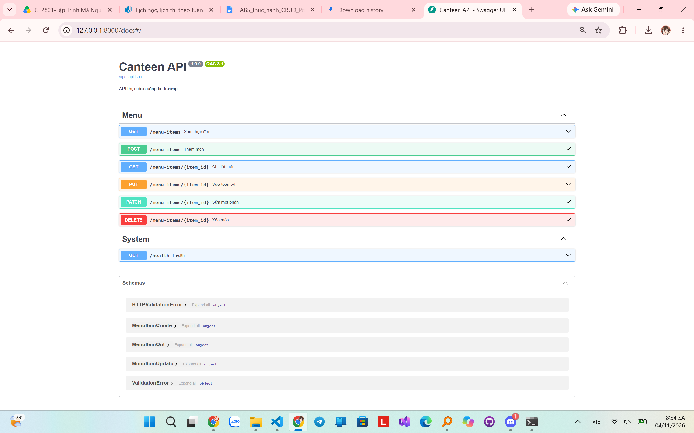
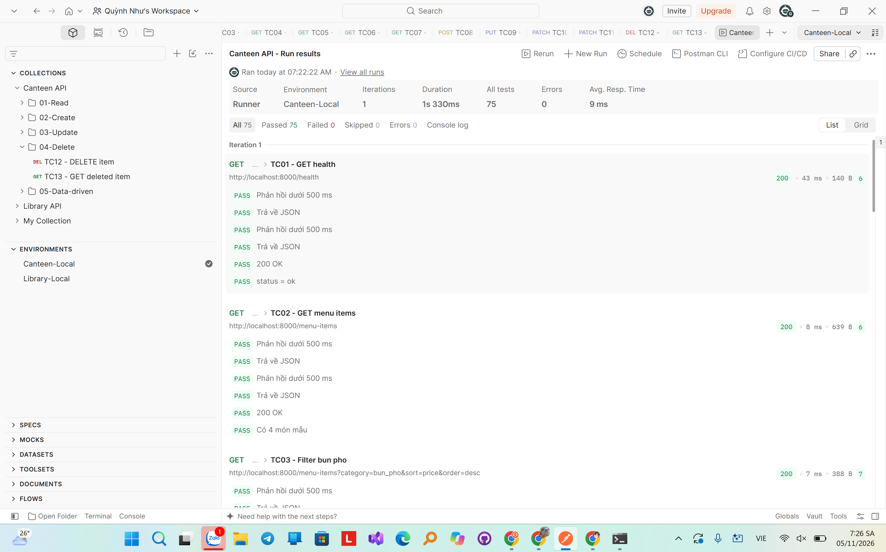
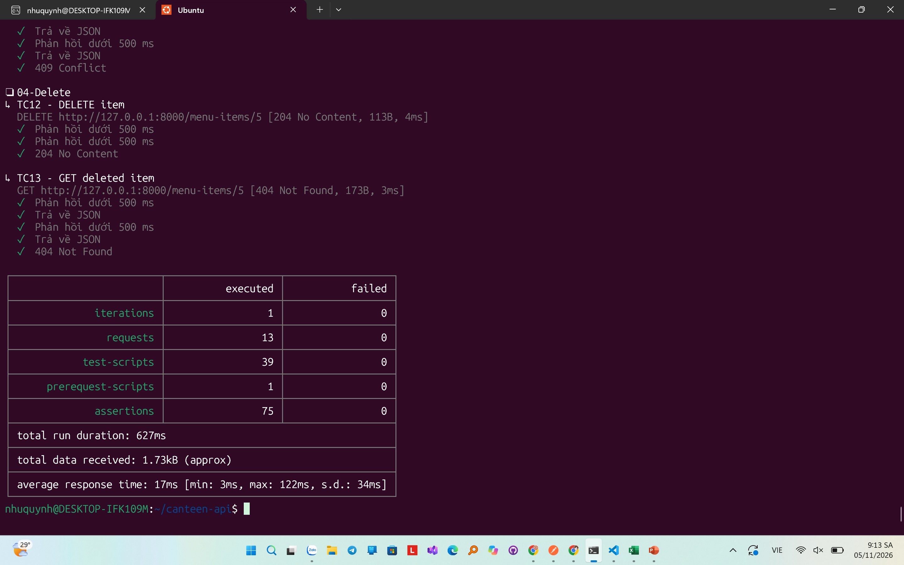
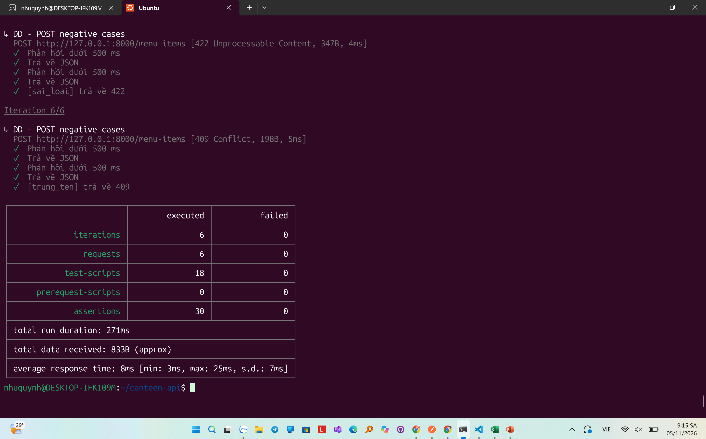

# LAB 5 - CANTEEN API

## 1. Thông tin sinh viên

- Họ và tên: Phạm Như Quỳnh
- Lớp: CT2801
- Học phần: Lập trình mã nguồn mở

## 2. Giới thiệu

Dự án Canteen API được xây dựng bằng Python và FastAPI, hỗ trợ quản lý thực đơn căng tin trường học.

Các chức năng chính:
- Xem danh sách món ăn.
- Lọc và sắp xếp thực đơn.
- Xem chi tiết món ăn.
- Thêm món ăn mới.
- Sửa toàn bộ hoặc một phần thông tin món.
- Xóa món ăn.

## 3. Công nghệ sử dụng

- Ubuntu / WSL
- Python
- FastAPI
- Pydantic
- Postman
- Newman
- Git và GitHub

## 4. Hướng dẫn chạy chương trình

Mở Ubuntu và truy cập thư mục dự án:

```bash
cd ~/canteen-api
source .venv/bin/activate
pip install -r requirements.txt
python -m uvicorn app.main:app --reload
```

Mở Swagger tại:

http://127.0.0.1:8000/docs

## 5. Các endpoint

| Method | Endpoint | Chức năng |
|---|---|---|
| GET | /menu-items | Xem thực đơn |
| GET | /menu-items/{id} | Xem chi tiết |
| POST | /menu-items | Thêm món |
| PUT | /menu-items/{id} | Sửa toàn bộ |
| PATCH | /menu-items/{id} | Sửa một phần |
| DELETE | /menu-items/{id} | Xóa món |

Ngoài ra có endpoint GET /health để kiểm tra hệ thống.

## 6. Kết quả kiểm thử

- Postman Collection Runner: 13 requests, 75 Passed, 0 Failed.
- Newman CRUD: 13 requests, 75 assertions, 0 Failed.
- Newman CSV: 6 iterations, 30 assertions, 0 Failed.

## 7. Hình ảnh minh chứng

### Swagger API



### Postman Collection Runner



### Newman CRUD



### Newman Data-driven CSV



## 8. Kết luận

Đã xây dựng thành công hệ thống Canteen API với 6 endpoint CRUD, áp dụng các quy tắc nghiệp vụ và kiểm thử tự động bằng Postman, Newman.
